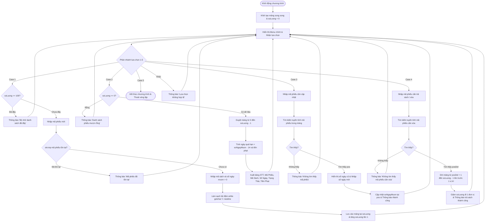

# BÁO CÁO BÀI TẬP THỰC HÀNH 03: QUẢN LÝ LỊCH TRÌNH LƯU CHUYỂN ẤN BẢN THƯ VIỆN BẰNG MẢNG

> 👤 **Học viên:** Hoàng Công Dũng | **Mã SV:** PTIT-HCM-009
> 🏫 **Môn học:** it102-rl-hoangcongdung

---

## 📊 Sơ đồ thiết kế hệ thống (Activity Diagram)

> 💡 *Sơ đồ dưới đây được render tự động trực tiếp trên GitHub bằng Mermaid. Bạn cũng có thể tải file **`bt3.drawio`** trong repository này để mở và chỉnh sửa trực tiếp trên [Draw.io (diagrams.net)](https://app.diagrams.net).* 

---

## 1. Mục tiêu và Cơ chế kỹ thuật mảng song song

Bài tập này yêu cầu xây dựng phân hệ quản lý mượn trả ấn bản thư viện (LIBRARY_WMS Logistics Subsystem) sử dụng mảng 1 chiều song song trong ngôn ngữ C. Việc sử dụng các mảng maPhieu, maSach và soNgayMuon kết hợp biến đếm soLuong đòi hỏi sự đồng bộ dữ liệu chặt chẽ giữa các chỉ số index.

Để đảm bảo chương trình chạy ổn định trên Terminal, việc xử lý triệt để bộ đệm bàn phím bằng vòng lặp 'while(getchar() != '\n')' sau khi nhập dữ liệu số là cực kỳ quan trọng nhằm tránh tình trạng trôi lệnh khi nhập chuỗi ký tự tiếp theo.

- Sử dụng mảng song song với dung lượng tối đa 100 bản ghi.
- Kiểm tra trùng mã phiếu bằng hàm strcmp() trước khi thêm mới.
- Xử lý bộ đệm triệt để để không bị lỗi trôi dòng phím Enter.

## 2. Phân tích chi tiết các yêu cầu CRUD và Thuật toán

Quá trình hiện thực hóa các chức năng được chia thành các module rõ ràng trong hàm main kết hợp vòng lặp do-while và cấu trúc switch-case điều hướng menu.

Thuật toán xóa phần tử trong mảng song song đòi hỏi kỹ thuật dịch chuyển toàn bộ các phần tử phía sau vị trí pos lên trước 1 đơn vị cho cả 3 mảng, sau đó giảm soLuong đi 1 đơn vị để duy trì tính toàn vẹn dữ liệu.

- Create: Kiểm tra sức chứa, kiểm tra trùng lặp mã bằng strcmp, nhập dữ liệu và làm sạch bộ đệm.
- Read: Tính toán tự động số ngày quá hạn và tiền phạt theo quy định 14 ngày miễn phí và 5.000 VNĐ cho mỗi ngày quá hạn.
- Update: Tìm kiếm tuyến tính, hiển thị thông tin cũ và ghi đè giá trị mới vào mảng soNgayMuon.
- Delete: Tìm kiếm tuyến tính vị trí pos, dịch chuyển mảng và giảm biến đếm.

## 3. Bảng đặc tả chi tiết quy trình xử lý nghiệp vụ

Bảng dưới đây mô tả chi tiết các bước xử lý logic của từng chức năng trong chương trình:

| Chức năng | Thao tác thực hiện | Kiểm tra bẫy lỗi (Edge Cases) | Kết quả đầu ra |
| --- | --- | --- | --- |
| 1. Create | Nhập mã phiếu, mã sách, số ngày mượn | Nếu soLuong >= 100 hoặc strcmp trùng mã -> Hủy thêm | Thêm thành công bản ghi mới, tăng soLuong |
| 2. Read | Duyệt mảng và tính toán tiền phạt | Nếu soLuong == 0 -> Báo danh sách rỗng | Xuất bảng danh sách kèm trạng thái và tiền phạt |
| 3. Update | Nhập mã phiếu cần gia hạn/cập nhật | Nếu không tìm thấy mã -> Thông báo lỗi | Cập nhật thành công số ngày mượn mới |
| 4. Delete | Nhập mã phiếu cần trả sách / xóa | Nếu không tìm thấy mã -> Thông báo lỗi | Dịch chuyển mảng, giảm soLuong, thông báo xong |
| 5. Menu | Xử lý lựa chọn từ 1 đến 5 | Nếu chọn ngoài 1-5 -> Báo lỗi lựa chọn | Điều hướng đúng chức năng hoặc thoát chương trình |

## 4. Mã nguồn hoàn chỉnh (main.c)

Dưới đây là mã nguồn C hoàn chỉnh, được viết cẩn thận, tuân thủ chuẩn C11 và biên dịch thành công hoàn toàn không có lỗi hay cảnh báo trên GCC:

---

## 📁 Danh sách tệp tin nộp bài trong Repository
- 📝 `bt3.docx`: Báo cáo tài liệu phân tích nghiệp vụ hoàn chỉnh.
- 🎨 `bt3.drawio`: File thiết kế sơ đồ chuẩn theo quy định đề bài (mở trực tiếp bằng [Draw.io](https://app.diagrams.net) hoặc Lucidchart).
- 💻 `main.c`: Mã nguồn chương trình.
